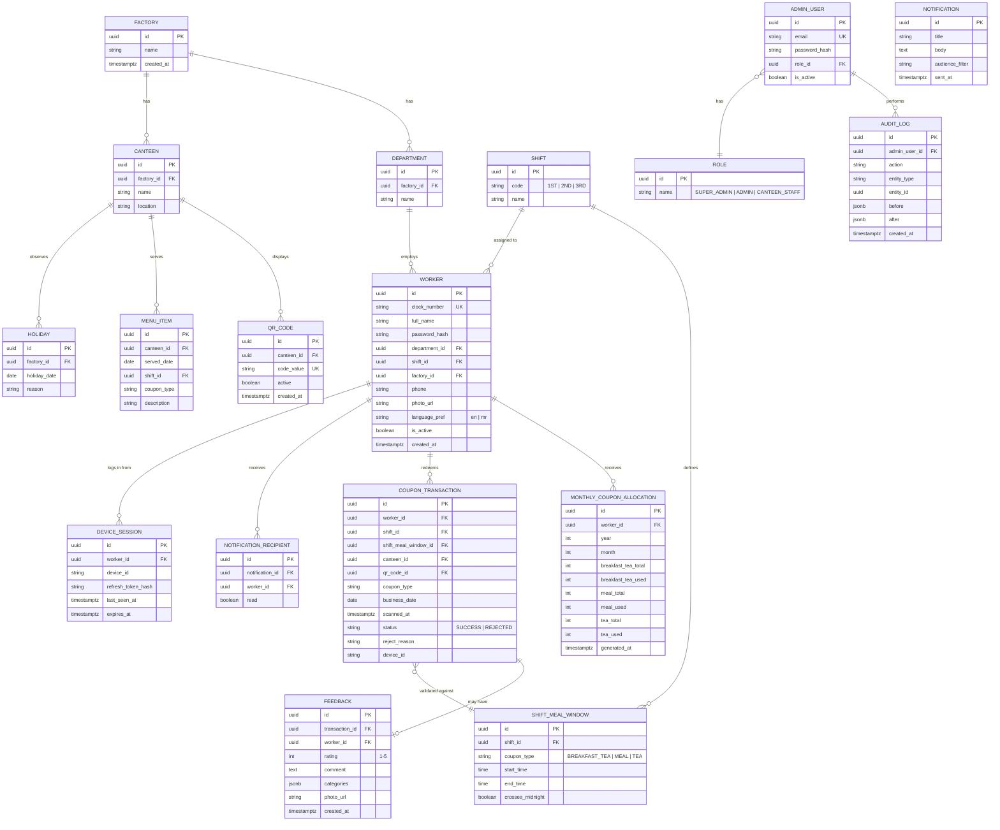

# Database Schema — PostgreSQL

## ER Diagram



## Key Constraints

- `worker.clock_number` — `UNIQUE`, used as login identifier.
- `monthly_coupon_allocation` — `UNIQUE (worker_id, year, month)`; created idempotently by the monthly cron job.
- `coupon_transaction` — partial unique index enforcing **max one SUCCESS transaction per (worker_id, coupon_type, business_date)**:
  ```sql
  CREATE UNIQUE INDEX uq_one_success_per_type_per_day
    ON coupon_transaction (worker_id, coupon_type, business_date)
    WHERE status = 'SUCCESS';
  ```
  This index is the ultimate source of truth for duplicate-scan prevention — even under concurrent requests, the second `INSERT` fails at the database level and is caught by the service layer as "already used today."
- Coupon balance decrements happen inside the same DB transaction as the `coupon_transaction` insert, using `SELECT ... FOR UPDATE` on the `monthly_coupon_allocation` row to serialize concurrent redemptions from the same worker.
- `shift_meal_window.crosses_midnight` handles the 3rd-shift windows (01:30–02:30, 03:30–04:30) where `business_date` is pinned to the shift's operational day rather than the calendar day of the scan.

## Indexes for Reporting

```sql
CREATE INDEX idx_txn_business_date ON coupon_transaction (business_date);
CREATE INDEX idx_txn_worker ON coupon_transaction (worker_id);
CREATE INDEX idx_txn_department_date ON coupon_transaction (business_date) INCLUDE (worker_id);
CREATE INDEX idx_worker_department ON worker (department_id);
CREATE INDEX idx_feedback_created_at ON feedback (created_at);
```

## Multi-Factory / Multi-Canteen Readiness

`factory_id` and `canteen_id` foreign keys are present on `department`, `worker`, `qr_code`, `menu_item`, and `holiday` from day one, so a future multi-factory or multi-canteen rollout is a query-scoping change, not a schema migration.
